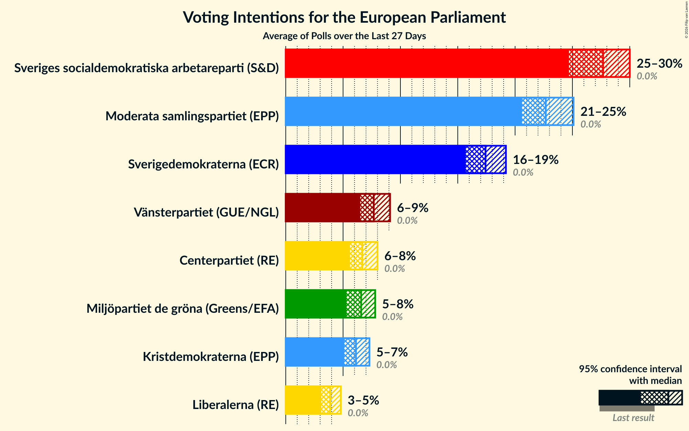
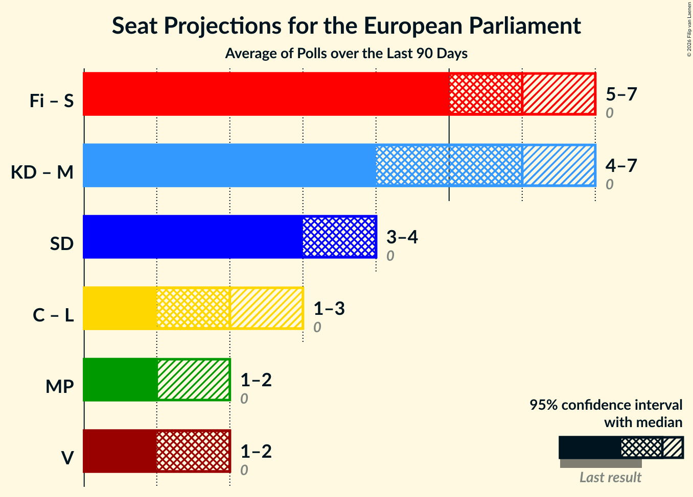

# Overview

The table below lists the most recent polls (less than 27 days old) registered and analyzed so far.

| Period     | Polling firm/Commissioner(s) | V | MP | S | Fi | L | C | M | KD | SD |
|:----------:|:----------------------------:|:--:|:--:|:--:|:--:|:--:|:--:|:--:|:--:|:--:|
| 9 June 2024 | General Election | 0.0%   0 | 0.0%   0 | 0.0%   0 | 0.0%   0 | 0.0%   0 | 0.0%   0 | 0.0%   0 | 0.0%   0 | 0.0%   0 |
| N/A | [Poll Average](average.html) | 6–9%   1–2 | 5–8%   1–2 | 25–30%   5–7 | N/A   N/A | 3–5%   0–1 | 6–8%   1–2 | 21–25%   4–6 | 5–7%   1–2 | 16–19%   3–4 |
| [28 September–11 October 2026](2026-10-11-Verian.html) | Verian   SVT | 7–9%   1–2 | 6–8%   1–2 | 27–30%   6–7 | N/A   N/A | 3–4%   0–1 | 5–7%   1–2 | 21–24%   4–5 | 5–7%   1 | 16–19%   3–4 |
| [5–11 October 2026](2026-10-11-Novus.html) | Novus   TV4 | 6–8%   1–2 | 6–8%   1–2 | 24–28%   5–6 | N/A   N/A | 3–5%   0–1 | 6–8%   1–2 | 22–26%   5–6 | 6–7%   1–2 | 17–20%   4 |
| [15–27 September 2026](2026-09-27-Ipsos.html) | Ipsos   Dagens Nyheter | 7–9%   1–2 | 5–7%   1–2 | 26–30%   5–7 | N/A   N/A | 3–5%   0–1 | 6–8%   1–2 | 20–24%   4–5 | 5–7%   1–2 | 15–19%   3–4 |
| 9 June 2024 | General Election | 0.0%   0 | 0.0%   0 | 0.0%   0 | 0.0%   0 | 0.0%   0 | 0.0%   0 | 0.0%   0 | 0.0%   0 | 0.0%   0 |

Only polls for which at least the sample size has been published are included in the table above.

**Legend:**
+ **Top half of each row:** Voting intentions (95% confidence interval)
+ **Bottom half of each row:** Seat projections for the European Parliament (95% confidence interval)
+ **V:** Vänsterpartiet (GUE/NGL)
+ **MP:** Miljöpartiet de gröna (Greens/EFA)
+ **S:** Sveriges socialdemokratiska arbetareparti (S&D)
+ **Fi:** Feministiskt initiativ (S&D)
+ **L:** Liberalerna (RE)
+ **C:** Centerpartiet (RE)
+ **M:** Moderata samlingspartiet (EPP)
+ **KD:** Kristdemokraterna (EPP)
+ **SD:** Sverigedemokraterna (ECR)
+ **N/A (single party):** Party not included the published results
+ **N/A (entire row):** Calculation for this opinion poll not started yet

